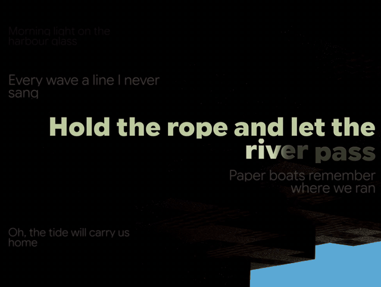
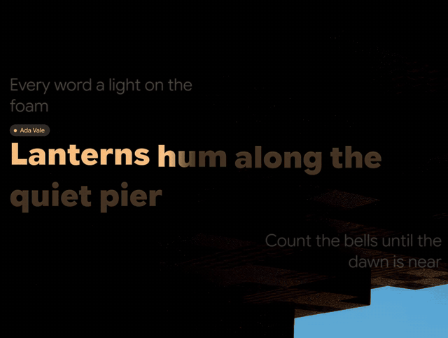
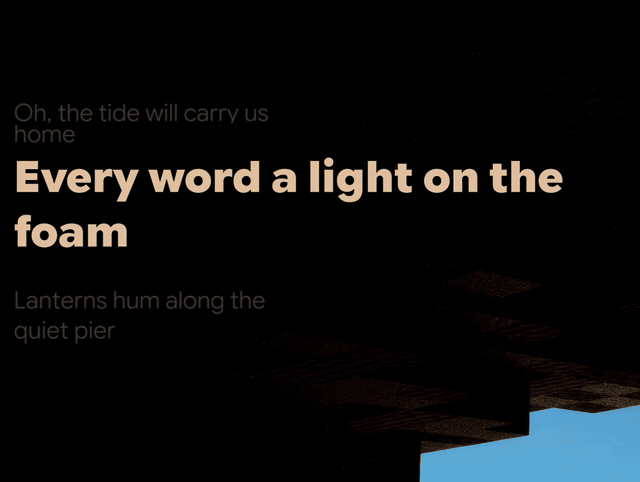

**Synced lyrics on your [DMS](https://github.com/duxlabs-dev/dux-shell) desktop.**

The DMS lyrics view as a desktop widget: word-by-word fill, one colour per singer, lines that
shrink as they move away.

[What it looks like](#what-it-looks-like) · [About](#about) · [Why it is light](#why-it-is-light) · [Settings](#settings) · [Requirements](#requirements)

## What it looks like

*The sung line fills word by word. Lines further from it get smaller.*

| One colour per singer | Player buttons on hover |
| --- | --- |
|  |  |

The demo song, its lyrics and its singers are made up for these captures.

## About

A floating desktop widget that shows DMS's own synced lyrics view: word-by-word fill, spring
scrolling, lines that grow into the centre, fill in the DMS theme colour.

Fork of [lildengzi/pureLyrics](https://github.com/lildengzi/pureLyrics). Version 2 drops the
plugin's own fetching and rendering. `lyrics/` holds a copy of DMS 2.1.2's `LyricsOverlay`,
`LyricsLine` and `LyricsModel.js` (MIT, see `lyrics/LICENSE-DMS`), changed for the options below.
The sung fill takes the DMS theme colour (`Theme.primary`) instead of the cover-art accent.

## Why it is light

- Lyrics come from DMS's shared `LyricsService`. The dash and this widget use one controller,
  so a song is fetched once.
- The controller wakes on word and line cues, not on a fixed poll.
- With **Smooth sweep** off (default), nothing redraws between cues. Turn it on for the gliding
  fill of the dash; it redraws every frame while a line is sung.
- The widget hides when no player is playing, and then drops its lyrics subscription.

## Settings

DMS Settings → Desktop Widgets → Pure Lyrics. A search field (Ctrl+F) on top, four tabs:

- **Text**: font (any installed family, or the DMS font), alignment (auto, left, centre, right, or
  follow the widget's side of the screen), singers on their side in duets, singer name chip (the artist and featured artists when the lyrics do not name voices; when
  the singer changes, while they sing, on hover, off), middle line size, other lines size, pyramid
  (each line further out is smaller), line spacing, active line weight, other lines weight,
  one line mode
- **Effects**: cover and title header until the first line (on the lyrics' side when they are
  aligned left or right), depth blur on the lines around the
  sung one, floating sung word, text shadow (on by default),
  active line glow (animates every frame), smooth sweep
- **Player**: previous / play-pause / next buttons, in a row under the sung line (centre, left,
  right, or the lyrics' side) or in a column beside it (left or right, centred on the sung line;
  shown always, it pushes the lyrics aside). Shown on hover or always, their opacity (below 100%
  they blur what is behind them when DMS blur is on), click a line to seek
- **Background**: background and border opacity

Lyrics synced per line only (no word timings from the provider) get word timings estimated from
word length, so they still fill word by word.

With several singers (lyrics that name voices, e.g. TTML), each singer takes a theme colour:
primary, tertiary, then secondary; group parts take secondary.

Instrumental breaks show DMS's wavy ring filling up until the next line.

After updating the plugin, restart DMS (`dms restart`): Quickshell keeps the old `lyrics/` types
cached across a plugin reload.

Lyrics providers, sync and the followed player come from DMS Settings → Media.

## Requirements

- DMS >= 2.1.2 with the lyrics backend (`dms` server capability `lyrics`)

## Plugin id

The id is `pureLyricsPlus`, not `pureLyrics`. DMS's registry already lists `pureLyrics` (the
upstream plugin), so with that id DMS showed the registry's metadata and checked this fork's
git remote for updates.

## License

MIT, see `LICENSE`. The files copied from DMS in `lyrics/` keep their own MIT notice
(`lyrics/LICENSE-DMS`).
