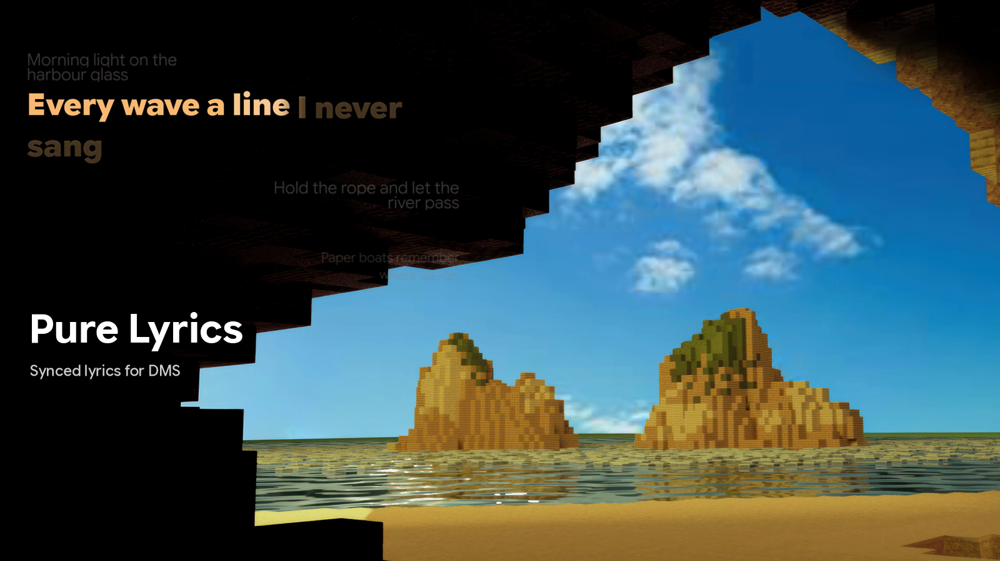
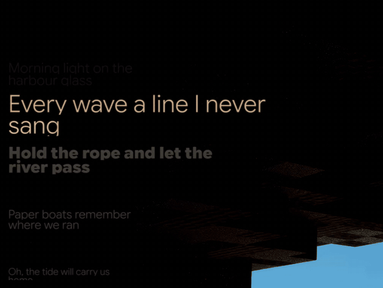
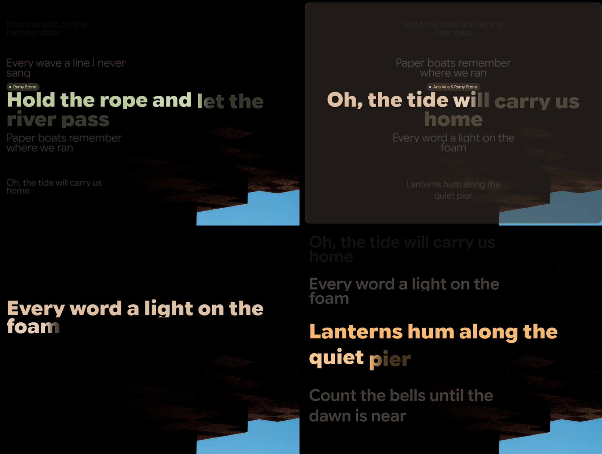
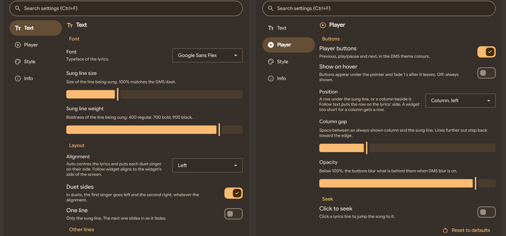

**Synced lyrics on your [DMS](https://github.com/duxlabs-dev/dux-shell) desktop.**

The DMS lyrics view as a desktop widget: word-by-word fill, one colour per singer, lines that
shrink as they move away.

[What it looks like](#what-it-looks-like) · [Before and after](#before-and-after) · [About](#about) · [Why it is light](#why-it-is-light) · [Settings](#settings) · [Requirements](#requirements)

## What it looks like

*The sung line fills word by word. Lines further from it get smaller.*

| One colour per singer | Player buttons on hover |
| --- | --- |
|  |  |

| Alignment follows the widget's side | Same song, four looks |
| --- | --- |
|  |  |

*Top row: default, centred with background. Bottom row: one line, flat.*

### Before and after

*Left: upstream pureLyrics at its defaults. Right: this fork. Same song, same moment.*

The demo song, its lyrics and its singers are made up for these captures.

## About

A floating desktop widget that shows DMS's own synced lyrics view: word-by-word fill, spring
scrolling, lines that grow into the centre, fill in the DMS theme colour.

Fork of [lildengzi/pureLyrics](https://github.com/lildengzi/pureLyrics). Version 2 drops the
plugin's own fetching and rendering. `lyrics/` holds a copy of DMS 2.1.2's `LyricsOverlay`,
`LyricsLine` and `LyricsModel.js` (MIT, see `lyrics/LICENSE-DMS`), changed for the options below.
The sung fill takes the DMS theme colour (`Theme.primary`) instead of the cover-art accent.

## Why it is light

- Lyrics come from DMS's shared `LyricsService`. The dash and this widget use one controller,
  so a song is fetched once.
- The controller wakes on word and line cues, not on a fixed poll.
- With **Smooth sweep** off (default), the fill only redraws on cues. Turn it on for the gliding
  fill of the dash; it redraws every frame while a line is sung. **Floating words** (on by
  default) also animate while a word is sung.
- The widget hides when no player is playing, and then drops its lyrics subscription.

## Settings

DMS Settings → Desktop Widgets → Pure Lyrics. Search with Ctrl+F (Esc clears). Options that do
nothing in the current setup stay hidden: player options while the buttons are off, the other
lines' options in one-line mode. **Reset to defaults** sits at the bottom (click twice).

- **Text**
  - *Font*: font (any installed family, or the DMS font), sung line size, sung line weight
  - *Layout*: alignment (auto, left, centre, right, or follow the widget's side of the screen),
    duet sides (first singer left, second right, when not on Auto), one line
  - *Other lines*: size, weight, shrink with distance (pyramid), fade with distance, spacing
- **Player**
  - *Buttons*: previous / play-pause / next, shown on hover or always, position (a row under the
    sung line: centre, left, right or the lyrics' side; or a column beside it, left or right),
    column gap (for a column shown always: the lines beside it step aside), opacity (below 100%
    they blur what is behind them when DMS blur is on)
  - *Seek*: click a line to seek
- **Style**
  - *Motion*: floating words, smooth sweep (redraws every frame while a line is sung)
  - *Depth*: depth blur on the lines around the sung one, text shadow (on by default), glow
    (animates every frame)
  - *Card*: background and border opacity
- **Info**
  - *Labels*: singer name chip (when the singer changes, while they sing, on hover, off; the artist
    and featured artists when the lyrics do not name voices), cover and title until the first line
    (on the lyrics' side when aligned left or right), lyrics source credit under the lyrics

Lyrics synced per line only (no word timings from the provider) get word timings estimated from
word length, so they still fill word by word.

With several singers (lyrics that name voices, e.g. TTML), each singer takes a theme colour:
primary, tertiary, then secondary; group parts take secondary.

Instrumental breaks show DMS's wavy ring filling up until the next line.

After updating the plugin, restart DMS (`dms restart`): Quickshell keeps the old `lyrics/` types
cached across a plugin reload.

Lyrics providers, sync and the followed player come from DMS Settings → Media.

## Requirements

- DMS >= 2.1.2 with the lyrics backend (`dms` server capability `lyrics`)

## Plugin id

The id is `pureLyricsPlus`, not `pureLyrics`. DMS's registry already lists `pureLyrics` (the
upstream plugin), so with that id DMS showed the registry's metadata and checked this fork's
git remote for updates.

## License

MIT, see `LICENSE`. The files copied from DMS in `lyrics/` keep their own MIT notice
(`lyrics/LICENSE-DMS`).
